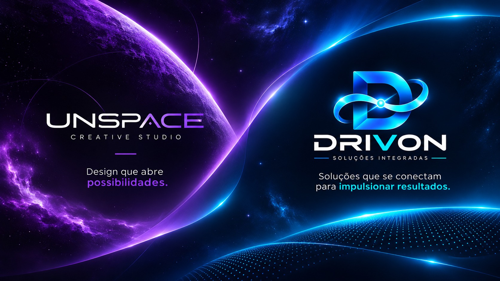

  

<h1 align="center">Olá, eu sou José Carlos Isoppo da Cunha 👋</h1>

<strong>Desenvolvedor de aplicações • Criador do ecossistema Drivon • UnSpace Creative Studio</strong>

Tecnologia e criatividade para transformar ideias em soluções para o dia a dia.

---

## 🚀 Sobre mim

Desenvolvo aplicações com **React Native, Expo e Firebase**, buscando soluções práticas para necessidades reais. Meus projetos conectam mobilidade, finanças, organização familiar e gestão.

Também atuo com design e comunicação visual na **UnSpace Creative Studio**, criando identidades, materiais de divulgação e vídeos promocionais para negócios.

## 🔵 Ecossistema Drivon

O Drivon reúne projetos voltados à organização e à gestão em diferentes áreas:

### 🚗 Drivon Driver
Ferramentas para motoristas de aplicativo e profissionais autônomos: jornadas, combustível, veículos, custos por quilômetro e relatórios.

[Ver APK](https://github.com/JIsoppo/JIsoppo/releases/tag/v1.0.0)

### 💰 Drivon Finance
Gestão financeira pessoal com receitas, despesas, planejamento, metas e relatórios.

[Ver APK](https://github.com/JIsoppo/JIsoppo/releases/tag/v1.1.0)

### 👨‍👩‍👧‍👦 Drivon Family
Organização de compras e informações compartilhadas entre membros da família, com recursos para listas e acompanhamento de preços.

[Ver APK](https://github.com/JIsoppo/JIsoppo/releases/tag/v1.2.0)

### 🏠 Drivon Imóveis
Gestão de imóveis e locações, incluindo unidades, contratos, vistorias e acompanhamento financeiro.

[Ver APK](https://github.com/JIsoppo/JIsoppo/releases/tag/drivon-imoveis)

## 🟣 UnSpace Creative Studio

Um espaço para unir **design, identidade visual e conteúdo audiovisual**, ajudando profissionais e negócios a apresentar suas marcas.

### ✨ UnSpace Marcas
Plataforma para criação e compartilhamento de portfólios online, com personalização para profissionais e empresas.

> Crie seu portfólio. Compartilhe sua marca.

[Conhecer o portfólio da UnSpace](https://unspace-marcas.vercel.app/p/unspace)
[Ver APK](https://github.com/JIsoppo/JIsoppo/releases/tag/unspace-marcas)

## 🔌 Outros projetos

### ElectroBox
Aplicativo para organizar componentes eletrônicos, documentar projetos e compartilhar conhecimento.

[Ver APK](https://github.com/JIsoppo/JIsoppo/releases/tag/EB-v1.0.0)

## 🛠️ Tecnologias

  &nbsp;&nbsp;
  &nbsp;&nbsp;
  &nbsp;&nbsp;
  &nbsp;&nbsp;
  

React Native · Expo · JavaScript · TypeScript · Firebase · Firestore · Git

## 📬 Vamos conversar?

- GitHub: [@JIsoppo](https://github.com/JIsoppo)
- E-mail: [mycreativedoublelife@gmail.com](mailto:mycreativedoublelife@gmail.com)
- Portfólio: [UnSpace Creative Studio](https://unspace-marcas.vercel.app/p/unspace)

---

<i>Ideias que conectam tecnologia, criatividade e pessoas.</i> 💜💙

